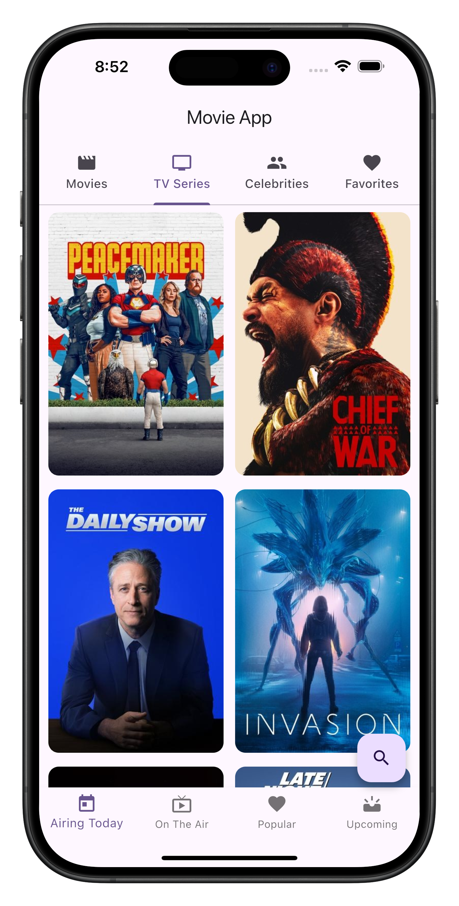
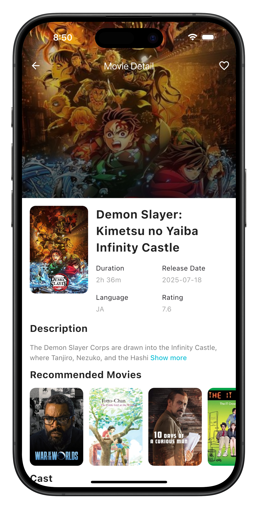
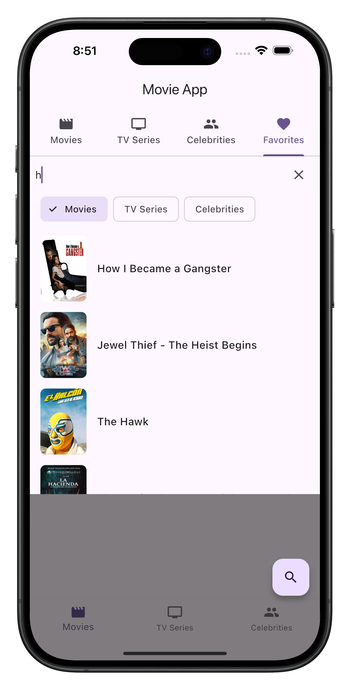
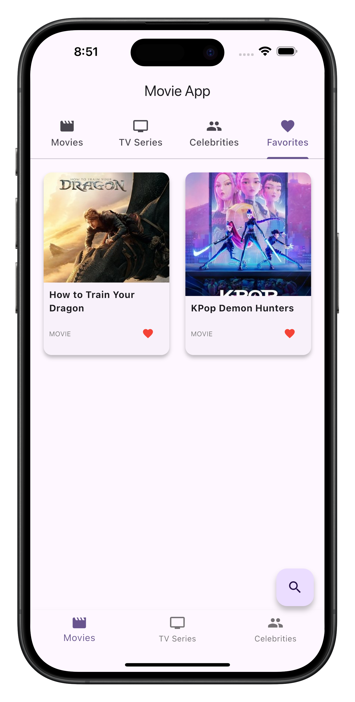
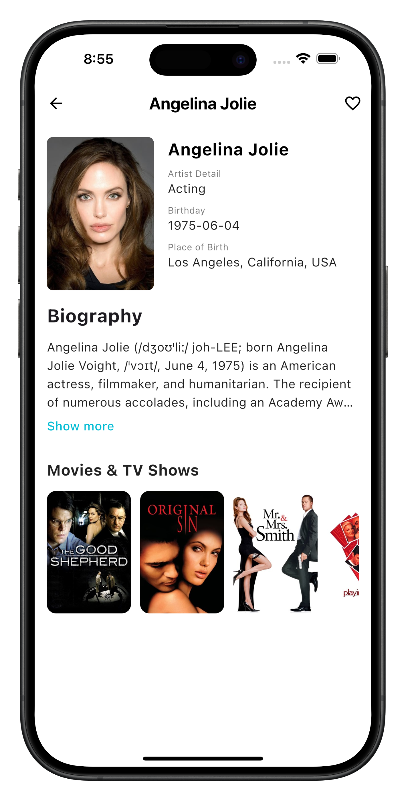

# Flutter Movie — Clean Architecture

[](https://flutter.dev)
[](https://dart.dev)
[](https://riverpod.dev)
[](https://github.com/piashcse/flutter-movie-clean-architecture/actions/workflows/ci.yml)
[](https://docs.flutter.dev/ui/accessibility-and-internationalization/internationalization)
[](https://opensource.org/licenses/MIT)
<a href="https://github.com/piashcse"></a>

A TMDB client for movies, TV series and celebrities built with Flutter,
Riverpod, go_router and a pragmatic Clean Architecture. It supports paginated
browsing, universal search, favourites, light/dark/system theming and
English/Spanish localisation.

<p align="center">
  
  
  
</p>
<p align="center">
  
  
  
</p>

## Features

- **Movies** — now playing, popular, top rated and upcoming (infinite scroll),
  details with cast/crew and recommendations.
- **TV series** — airing today, on the air, popular and upcoming, details with
  cast and recommendations.
- **Celebrities** — popular and trending people, artist detail with combined
  movie/TV credits.
- **Universal search** — debounced, category-aware (movies / TV / people) and
  fully typed.
- **Favourites** — offline persistence with Hive, optimistic updates with
  rollback on storage failure.
- **Theming** — light/dark/system preference persisted locally; all colours come
  from the Material 3 `ColorScheme`.
- **Localisation** — generated `AppLocalizations` (ARB) for English and Spanish
  with an in-app language switcher.

## Architecture

```
presentation  →  domain  ←  data
   (UI, Riverpod)   (entities, repositories)   (datasources, models, repository impls)
```

Key decisions:

- **No ceremonial use-case layer.** Providers call repositories directly; use
  cases are introduced only when real business logic exists.
- **Models are mapped once.** Freezed data models expose `toEntity()` extension
  mappers in `data/models/mappers.dart`; repositories never repeat field
  mapping.
- **Typed failures.** `TmdbClient` and the Hive layer convert every error into
  an `AppFailure`; the UI renders a translated message from `FailureKind`.
- **Generic UI building blocks.** `PagedMediaGrid<T>`, `MediaHubPage`,
  `DetailHeader`, `DetailInfoSection`, `RecommendationsSection<T>` and
  `CreditsSection` remove duplicated screens across features.
- **Favourites have domain/data layers** (`FavoriteItem` + repository), so the
  UI never touches Hive models.
- **Configuration is injected** with `--dart-define`; nothing sensitive is
  bundled as an asset.

### Project structure

```
lib/
├── main.dart                     # bootstrap, error hooks, ProviderScope
├── core/
│   ├── config/                   # TMDB endpoints + image helpers
│   ├── entities/                 # shared Credits and SearchResult types
│   ├── error/                    # AppFailure, mapping, reporter
│   ├── hive/                     # Hive lifecycle
│   ├── localization/             # locale provider, l10n extension, switchers
│   ├── models/                   # shared CreditModel
│   ├── network/                  # Dio, retry/log interceptors, TmdbClient
│   ├── storage/                  # KeyValueStore abstraction
│   ├── theme/                    # Material 3 themes + theme mode
│   ├── utils/                    # formatting + responsive layout
│   └── widgets/                  # shared UI building blocks
├── features/
│   ├── movie/{data,domain,presentation}
│   ├── tv_series/{data,domain,presentation}
│   ├── celebrity/{data,domain,presentation}
│   └── favorites/{data,domain,presentation}
├── l10n/                         # ARB sources + generated localizations
├── presentation/                 # shell page + universal search
└── routing/                      # AppRoutes, router provider, navigation helpers
```

## Getting started

### Prerequisites

- Flutter 3.44.2 or newer (Dart 3.12)
- A free [TMDB API key](https://www.themoviedb.org/settings/api)

### Configure the API key

Copy the example config and add your key:

```bash
cp assets/config/env.example.json assets/config/env.json
# edit assets/config/env.json → {"TMDB_API_KEY": "your_key"}
```

`assets/config/env.json` is bundled as an asset and read at startup, so no
launch flags are required:

```bash
flutter pub get
flutter gen-l10n
dart run build_runner build
flutter run
```

For CI or release builds you can inject the same value at compile time instead
(it takes precedence over the asset):

```bash
flutter build apk --release --dart-define=TMDB_API_KEY=your_key
# or
flutter run --dart-define-from-file=assets/config/env.json
```

`assets/config/env.json`, `.env` and signing material are git-ignored.

> **Seeing the "No TMDB API key configured" screen?**
> `assets/config/env.json` is missing, empty, or contains the placeholder. Copy
> `env.example.json` as shown above and fully restart the app (hot reload does
> not re-read the asset). VS Code users can also pick the included
> **Flutter (env.json)** launch configuration.


### Useful commands

```bash
flutter analyze                 # strict analysis (0 issues expected)
dart format lib test            # format hand-written sources
flutter test                    # unit + widget tests
flutter test --coverage         # lcov report in coverage/lcov.info
dart run build_runner watch     # regenerate freezed/json while developing
```

## Localisation

Strings live in `lib/l10n/app_en.arb` and `lib/l10n/app_es.arb`; the
`AppLocalizations` class is generated by `flutter gen-l10n` (configured in
`l10n.yaml`). Access strings with the `context.l10n` extension:

```dart
Text(context.l10n.recommendedMovies)
```

When adding a key, add it to **all** ARB files.

## Security

TMDB's v3 key is sent as a query parameter and, like any value shipped in a
mobile app, can be extracted from the binary. For a production deployment,
proxy TMDB requests through your own backend so the key never leaves the
server. Requests are HTTPS-only (ATS restrictions restored on iOS) and the
debug logger never prints query strings, headers or bodies.

## CI

`.github/workflows/ci.yml` runs formatting checks, `flutter analyze`, the test
suite with coverage and a debug APK build on every push and pull request.
Dependabot keeps pub and GitHub Actions dependencies up to date.

## 👨‍💻 Developed By

<a href="https://twitter.com/piashcse" target="_blank">
  
</a>

**Mehedi Hassan Piash**

[](https://twitter.com/piashcse)
[](https://medium.com/@piashcse)
[](https://www.linkedin.com/in/piashcse/)
[](https://piashcse.github.io/)
[](https://piashcse.blogspot.com)

## 📄 License

```
MIT License

Copyright (c) 2025 piashcse (Mehedi Hassan Piash)

Permission is hereby granted, free of charge, to any person obtaining a copy
of this software and associated documentation files (the "Software"), to deal
in the Software without restriction, including without limitation the rights
to use, copy, modify, merge, publish, distribute, sublicense, and/or sell
copies of the Software, and to permit persons to whom the Software is
furnished to do so, subject to the following conditions:

The above copyright notice and this permission notice shall be included in all
copies or substantial portions of the Software.

THE SOFTWARE IS PROVIDED "AS IS", WITHOUT WARRANTY OF ANY KIND, EXPRESS OR
IMPLIED, INCLUDING BUT NOT LIMITED TO THE WARRANTIES OF MERCHANTABILITY,
FITNESS FOR A PARTICULAR PURPOSE AND NONINFRINGEMENT. IN NO EVENT SHALL THE
AUTHORS OR COPYRIGHT HOLDERS BE LIABLE FOR ANY CLAIM, DAMAGES OR OTHER
LIABILITY, WHETHER IN AN ACTION OF CONTRACT, TORT OR OTHERWISE, ARISING FROM,
OUT OF OR IN CONNECTION WITH THE SOFTWARE OR THE USE OR OTHER DEALINGS IN THE
SOFTWARE.
```
